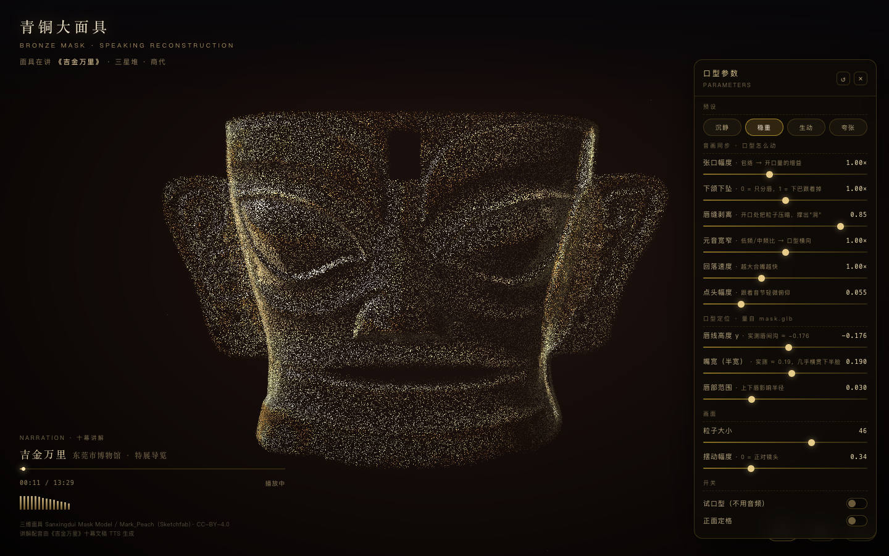

# 青铜大面具 · 粒子重构与开口讲解

把一个三星堆青铜面具的摄影测量模型采成 82 万粒子的点云，并让它跟着讲解音频开口说话。

> A 820k-particle point-cloud reconstruction of a Sanxingdui bronze mask — and a mode where the
> mask's mouth is driven by the narration's audio envelope, so the statue appears to give the tour.

**在线预览 · Live demo：** <https://initias.github.io/bronze-mask-talk/>
（直接进 [开口讲解](https://initias.github.io/bronze-mask-talk/talk.html) /
[戴上面具](https://initias.github.io/bronze-mask-talk/face.html)；face 页需要摄像头授权）



---

## 三个页面

| 入口 | 内容 |
|---|---|
| `index.html` | 粒子重构：外轮廓先到 → 面中段填满 → 双眼最后点亮；鼠标划过吹散粒子，滚轮推拉 |
| `face.html` | 摄像头 + MediaPipe 面部识别，把面具戴到真人脸上 |
| `talk.html` | **开口讲解**：播放 13 分 29 秒讲解音频，面具跟着音节动口型，参数实时可调 |

## 跑起来

```bash
npm install
npm run dev        # 按终端提示的地址，路径换成 /talk.html
```

无需 API key、无需联网（模型与音频都在仓库里）。

---

## 一、点云是怎么来的

`src/scene/sampleMesh.js` 把网格按**面积加权**采样成点云：

1. 收集世界坐标三角面，用中位面积 ×40 做阈值，剔除摄影测量补洞留下的桥接大三角；
2. 用 1%–99% 分位包围盒代替 min/max 归一化，剔掉扫描碎片；
3. 最薄的一轴判为深度轴，转 90° 让面具正对 +Z，再用二阶矩做一次偏航校正；
4. 逐点优先取贴图颜色、其次顶点色，最后按亮度映射到青铜色阶；
5. 输出 `position / aColor / aNorm / aSize / aOrder / aEye`——`aOrder` 决定叙事分段
   的到达顺序（轮廓先、面中段次之、双眼最后），`aEye` 给"点亮双眼"用。

着色器见 `src/scene/MaskParticles.jsx`：真实法线光照、朝向剔除、鼠标速度驱动的粒子吹散。

## 二、让面具开口

模型是**静态壳体**，没有骨骼也没有 blendShape，所以"张嘴"只能在顶点着色器里做
**解析式区域形变**：

- 以唇线为轴，上下唇沿 y 反向让开。**不等分**：上唇吃 0.35、下唇吃满 1.0——
  上唇长在刚性面壳上，真正能动的是下颌；
- 唇线以下按距唇线的距离 `smoothstep` 加权，让下颌整体下坠；
- 唇缝附近压暗并降低 alpha，把缺口抹成洞；
- 唇缘补一档光，区分"张开的嘴"和"少了一层粒子的破面"。

### 唇线的位置是量出来的

把模型按上面的流程归一化后（面具中心为原点，最大边 = ±0.5），沿中轴做 z–y 剖面：

| 特征 | y | z |
|---|---|---|
| 鼻尖 | −0.085 | 0.315（全脸最高） |
| 鼻底 | −0.105 ~ −0.115 | 0.275 → 0.235（点数骤增 3 倍 = 陡立面） |
| 唇上缘 | −0.163 | 0.213 |
| **唇间沟** | **−0.176** | **0.199（局部最低）** |
| 唇下缘 | −0.197 | 0.225 |

横向半宽 ≈ 0.19，几乎贯穿下半脸——三星堆面具的嘴本来就这么宽。
这三个数就是 `MOUTH_DEFAULT`，也是面板里三个滑块的默认值。

复现方法见 `mouthprobe.html`：把正面点云的 z 用 z-buffer 铺成高度图，**先做可分离盒式
模糊再算梯度**（点云每像素只有一个样本，不模糊的山体阴影全是雪花），叠网格直接读数。

## 三、音频 → 口型

`src/talk/audio.js`：`MediaElementSource → Analyser(1024)` 逐帧取时域 RMS。

- **峰值跟随器自动标定**满刻度：涨得快（0.3 s）、落得慢（6 s），下限 0.055。
  换任何一版配音都不用重调阈值；
- `GATE = 0.28 × ref`（句间停顿 → 闭嘴）、`TOP = 1.15 × ref`（满张口）；
- `open = pow(norm, 0.62)`，把中低段抬起来，普通音节也有明显口型；
- 非对称平滑：起音 35 ms、回落 115 ms——人说话就是"张得快、合得缓"。

这两个系数是把整条 810 秒音频离线扫出来的（`calib_audio.py`），得到开口量
**p50 = 0.495、p90 = 0.909、峰值饱和率 1.5%**：既不会一直张到最大，也不会只有重音才动。

**没有做音素 / viseme 识别。** 几十毫秒级的分类在这种点云密度上读不出来，
误判反而会让嘴乱跳。宽窄只用 F1/F2 能量比做微调，够用即可。

## 四、参数与导出

右侧面板 11 个滑块 + 四档预设（沉静 / 稳重 / 生动 / 夸张），全部实时生效；
底部「录制」把画布与讲解音轨合成一个 webm（VP9 + Opus，画布原始分辨率）导出。

细节（参数全表、URL 调试参数、换模型/换配音怎么处理）见 **[讲解页说明.md](讲解页说明.md)**。

---

## 目录

```
.
├── index.html / face.html / talk.html     三个入口
├── src/
│   ├── scene/MaskParticles.jsx            点云着色器 + 开口形变
│   ├── scene/sampleMesh.js                网格 → 点云
│   ├── talk/TalkApp.jsx                   讲解页
│   ├── talk/audio.js                      音频包络
│   ├── face.js                            戴面具
│   └── assets/mask.glb                    面具模型
├── public/
│   ├── narration.mp3                      讲解音频（13:29）
│   ├── models/face_landmarker.task        MediaPipe 人脸模型
│   └── wasm/                              MediaPipe 运行时
├── mouthprobe.html                        唇线定位探针
├── calib_audio.py                         开口量标定
└── *.mjs                                  截图 / 校验脚本（puppeteer-core）
```

## 已知限制

- **不是真口型同步**：只有"开合 + 宽窄"两个自由度。要读唇形不够，要"看起来在讲解"够了；
- `open = 1` 时下颌位移约 0.056（归一化单位，≈ 脸高的 8%），再大下唇会与面壳脱离；
- 换模型要重量唇线；换配音不用改代码；
- 录制只含 WebGL 画布本体，不含页面 UI 与暗角——当素材用正合适。

## 署名

三维面具：**Sanxingdui Mask Model / Mark_Peach（Sketchfab）· CC-BY-4.0**
——页面左下角常驻署名，二次分发请保留。

讲解文稿与配音为《吉金万里——中国西南及岭南地区青铜文明特展》（东莞市博物馆）导览内容，
由 TTS 生成，仅作教学演示。
